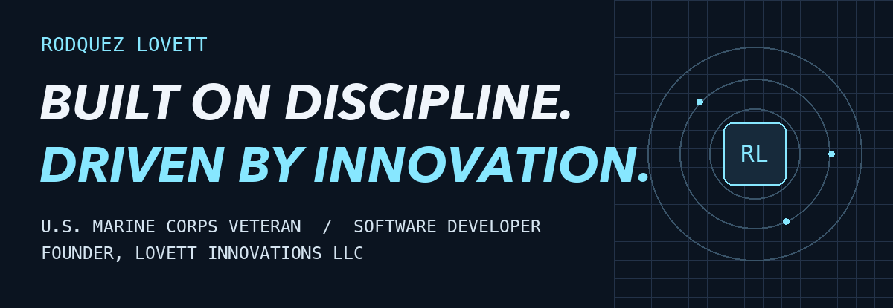

# Rodquez Lovett

I led an infantry fire team in the U.S. Marine Corps, then moved into aviation logistics information systems. The work changed, but the habits carried over. Know who depends on the system, account for what can go wrong, and leave the next person with a clear handoff.

Today I’m a software developer and the founder of Lovett Innovations LLC. I build web and mobile applications and work on automation for tasks such as capturing inquiries, coordinating follow-up and processing media. I’m studying computer science through an Associate in Arts pathway at Miami Dade College.

## What I’m building

- **The Guest List** · In active development. A venue discovery and guest-operations project with Next.js, Expo, TypeScript, Supabase and PostGIS. [Florida discovery site](https://the-guest-list-florida.rodsolo.chatgpt.site/)
- **LeadPilot** · Working prototype with a hosted sandbox. Inquiry intake and follow-up workflows built around Next.js, TypeScript and Supabase. [Try the sandbox](https://lovett-leadpilot.rodsolo.chatgpt.site/demo)
- **S.O.L.O.** · In active development. Mobile profiles, discovery and opportunities for independent professionals using React Native, Expo and Supabase. [Project website](https://solo-ascension.rodsolo.chatgpt.site/)
- **Lovett AI Clipper** · Working prototype. Prior Clip Studio records document a Python and FFmpeg worker for queued video processing.
- **TallyShift** · Native iOS work in active development. Shift and earnings records using SwiftUI and SwiftData. [Support site](https://tallyshift-help.rodsolo.chatgpt.site/)

## Engineering focus

| Area | What I’ve worked with |
| --- | --- |
| Web | TypeScript, JavaScript, React and Next.js |
| Mobile | React Native and Expo, with SwiftUI project experience |
| Backend and data | Supabase authentication and storage, PostgreSQL, SQL and PostGIS |
| Automation | Python, FFmpeg, background jobs and approval checks for follow-up |
| Development | Git, GitHub, Xcode and build and test workflows |

I like to document how a decision was made and what a test actually proves. For example, an RSVP and a door check-in are separate facts, and an automation should stay disabled until the people responsible for it can review its setup. I’m continuing to build depth in AI integration and software architecture.

## Connect

[Lovett Innovations LLC](https://lovett-innovations.rodsolo.chatgpt.site/) · [LinkedIn](https://www.linkedin.com/in/rodquez-lovett-241260328/) · [Email](mailto:rodquez.d.lovett@gmail.com)

**From Mission Planning to Product Building.**

Always learning. Always building. Always improving.
